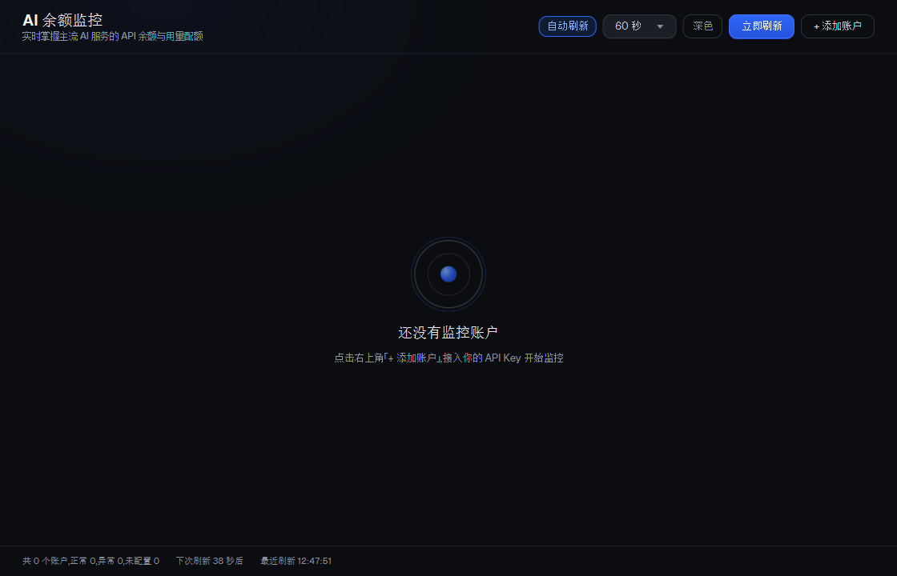
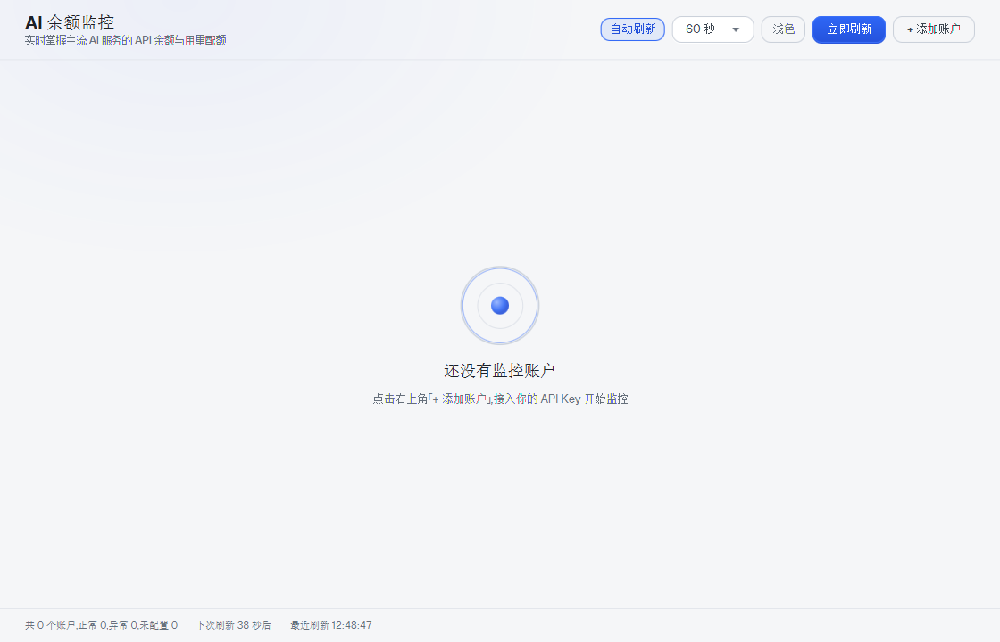

# AI 余额监控（ai-balance-monitor）

一个基于 **Java 17 + JavaFX** 的桌面工具：接入市面上主流 AI 服务的 API，**实时查看账户余额与用量配额**。




> 亮色空状态：

## 功能特性

- **一键接入主流 AI 服务（共 25 个入口）**：
  - **国内**：DeepSeek、Kimi 月之暗面（中国区）、硅基流动 SiliconFlow（官方余额接口已下线）、智谱 GLM、MiniMax 海螺（中国站）、Kimi Coding 套餐、阿里云百炼·Token Plan 额度、阿里云百炼·账户余额与账单（中国站）、火山方舟、腾讯混元、百度千帆、阶跃星辰 StepFun、小米 MiMo、云知声 Unisound、魔塔社区 ModelScope（魔粒余额）、Qoder（国内站）
  - **海外**：Kimi（国际区）、MiniMax 海螺（国际站）、OpenAI（API Key / Admin Key）、Anthropic Claude、Google Gemini（API Key / Cloud 账单）、xAI Grok、阿里云百炼·账户余额与账单（国际站）、Qoder（国际站）
  - **中转站**：OneAPI / NewAPI 网关、OpenRouter、CommandCode、OpenCode Go、ToAPIs、ZenMux
- **服务选型弹窗（图标网格）**：添加/编辑账户时点击「服务」打开弹窗，各厂商以**官方 logo 图标卡片**网格展示，按 **国内厂商 / 海外厂商 / 中转站** 分区布局，中转站（OneAPI、OpenRouter）置于最下方；logo 资源离线打包，深色/浅色主题均正常显示，无 logo 的服务自动回退品牌色徽标
- **实时刷新**：自动刷新（15 秒 / 30 秒 / 60 秒 / 5 分钟可调）或手动刷新；所有账户**并行查询、互不阻塞**
- **每账户独立状态**：在线 / Key 无效 / 请求超时 / 查询失败 / 未配置，单点失败不影响其他卡片
- **Token 计划（套餐）额度**：智谱 GLM Coding Plan、MiniMax Token Plan、Kimi Coding 套餐的 5 小时/周窗口额度；阿里云百炼 Token Plan 的 Credits 剩余额度；OpenRouter Key 配额（limit/usage）与账户 Credits；OpenAI Admin Key 的组织级费用与用量；Claude 响应头速率配额
- **计费形式明确标注**：添加账户时表单自动显示该服务的计费形式标签（按量付费余额 / 按量付费配额 / 订阅套餐额度 / 云账户余额+账单 / 网关额度等），名称输入框示例随所选服务切换，避免误写成其他厂商名称
- **Base URL 全服务可配**：所有服务均显示 Base URL 输入框并**预填官方默认地址**（如 DeepSeek `https://api.deepseek.com`、阿里云百炼中国站 `https://business.aliyuncs.com`），可手动修改为自定义 / 代理地址（网关类无官方通用域名，需自行填写，已明确标注必填）
- **明暗双主题**：右上角一键切换深色/浅色，选择持久化到本地配置，重启后保持；**Windows 系统标题栏同步跟随主题**（经 DWM `DWMWA_USE_IMMERSIVE_DARK_MODE` 属性设置，否则深色界面会配一条系统默认标题栏）
- **添加账户表单带滚动条**：内容超高时在框内滚动，小屏/高 DPI 下信息不超出屏幕，对话框可缩放
- **卡片菜单**：每张卡片右上角「⋯」提供立即刷新 / 编辑 / 启用停用 / 删除，弹层在双主题下均可正常显示
- **强制 HTTPS**：所有请求仅允许 `https://` 地址，明文 `http://` 一律拒绝，避免 API Key 在链路上被窃听；强制 HTTP/1.1 并显式启用 TLSv1.2/1.3，规避代理/中间设备的握手兼容问题
- **网络模式可切换**：顶部「跟随系统 / 直连」开关（自动读取系统代理，企业代理 / Clash 等场景无需手动配置；出现 TLS 握手失败时可切「直连」排查）
- **API Key 加密存储**：Windows 下使用 **DPAPI（CryptProtectData）** 加密后落盘（密文带 `dpapi:` 前缀），配置文件不再含明文 Key；旧版明文配置首次保存时自动迁移
- **空状态动效**：无账户时同心圆插图呈**呼吸缩放 + 核心脉冲 + 4 秒涟漪**循环动画；空状态出现/消失、卡片状态更新、主题切换均带缓和过渡动画
- **本地配置**：账户、刷新间隔与主题保存在本机 `~/.ai-balance-monitor/config.json`，原子写入防损坏。**读取失败时绝不覆盖原文件**：只另存一份 `config.corrupted-<时间戳>.bak` 供取证（原文件留在原地），并进入只读保护——启动时弹窗提示，本次运行不写回任何配置，避免「一次解析失败 → 空配置被反复保存 → 账户与密钥全丢」；修复或移走该文件后重启即恢复
- **账户展示条目持久化**：卡片「展示条目」里勾选的条目随配置一起保存，不会被其他设置变更清空
- **可扩展**：新增服务只需实现 `BalanceProvider` 接口并在 `ProviderRegistry` 注册一行

## 支持的 AI 服务与数据口径

### 国内厂商

| 服务入口 | 查询方式 | 展示内容 |
| --- | --- | --- |
| DeepSeek 深度求索 | 官方接口 `GET /user/balance` | 账户余额（总/充值/赠送）、可用状态 |
| Kimi 月之暗面（中国区） | 官方接口 `GET /v1/users/me/balance` | 可用余额、现金余额、代金券 |
| Kimi（国际区） | 同上，默认 `https://api.kimi.ai` | 同上；国内 / 国际 Key 相互独立 |
| 硅基流动 SiliconFlow | `GET /v1/user/info`——官方已于 **2026-08-14 停止服务**（410 Gone，无替代 API） | 存量账户提示「官方余额接口已下线」，不再展示余额 |
| 智谱 GLM | **双计费**：Coding Plan 订阅（`GET /api/monitor/usage/quota/limit`，订阅 Key）；按量付费（`GET /api/paas/v4/balance`，普通 Key） | 套餐：5 小时/周窗口已用与剩余百分比、套餐档位、重置时间；按量：可用余额/总额/已用（按模型明细） |
| MiniMax 海螺（中国站 / 国际站） | **双计费**：Token Plan 订阅（`GET /v1/token_plan/remains`，订阅 Key）；按量付费（`GET /v1/models` 校验，普通 Key，钱包余额无公开 API）。**套餐接口 HTTP 恒 200，业务错误在 `base_resp.status_code`（1004=鉴权失败）** | 套餐：5 小时/周窗口额度百分比与重置时间；按量：Key 有效性 + 速率配额（如实标注无余额接口） |
| Kimi Coding 套餐 | `GET /coding/v1/usages`（Kimi Code 订阅 Key） | Coding 套餐额度：5 小时速率窗口与周请求池已用/剩余 |
| 阿里云百炼·Token Plan 额度 | 官方 OpenAPI `ListSubscriptionSharedPackages` + `GetSubscriptionSeatDetails`（域名 `modelstudio.cn-beijing.aliyuncs.com`，**ACS3-HMAC-SHA256 签名**，填阿里云 AccessKey ID/Secret；RAM 需 `AliyunModelStudioReadOnlyAccess`） | 各订阅席位/共享包 **Credits 周期总额与剩余额度进度条**、周期起止时间、席位类型与状态；主金额 = 全部 Credits 剩余之和 |
| 阿里云百炼·账户余额与账单（中国站） | 阿里云官方 SDK（BssOpenApi 2017-12-14）：`QueryAccountBalance` + `QueryAccountBill`；中国站 endpoint `business.aliyuncs.com`，填中国站 AccessKey ID/Secret；RAM 需 `AliyunFinanceConsoleReadOnlyAccess` | 账户余额、可用现金、信控额度 + 当月账单费用明细（账单接口失败不阻断余额展示） |
| 火山方舟 | 费用中心 `QueryBalanceAcct`（`billing.volcengineapi.com`，AK/SK 签名） | 可用余额、现金余额、欠费、冻结、信控额度 |
| 腾讯混元 | 计费 `DescribeAccountBalance`（`billing.tencentcloudapi.com`，TC3-HMAC-SHA256，SecretId/SecretKey） | 可用余额、现金余额、信用额度、冻结金额、欠费（金额单位为分） |
| 百度千帆 | `POST /v1/finance/cash/balance`（`billing.baidubce.com`，bce-auth-v1，AK/SK） | 现金余额（元） |
| 阶跃星辰 StepFun | 官方接口 `GET /v1/accounts` | 账户余额、累计充值、剩余赠送、账户类型（预付费/后付费） |
| Qoder（国内站） | 官方 OpenAPI：PAT 兑换 Job Token 后 `GET /api/v2/quota/usage`（qoder.com.cn → 个人访问令牌） | 剩余 Credits、总配额、已用、赠额、当前套餐与到期时间（组织 Key 可展示组织资源包） |
| 小米 MiMo | **双计费**（按量 Key 前缀 `sk-`；Token Plan 专属 Key + 专用地址 `https://token-plan-cn.xiaomimimo.com/v1`）均无公开余额/额度接口：`GET /v1/models` 校验 Key + 响应头速率配额（尽力） | Key 状态、计费形态标注、令牌/请求配额剩余（网关返回时展示）；额度数值需到控制台查看 |
| 云知声 Unisound | **双计费**（按量 Key 前缀 `sk-`；Token Plan 专属 Key 前缀 `tp-`）均无公开余额/额度接口：同小米做法 | Key 状态、计费形态标注、令牌/请求配额剩余（网关返回时展示）；额度数值需到控制台查看 |
| 魔塔社区 ModelScope | 官方「魔粒」余额接口 `GET https://www.modelscope.cn/openapi/v1/magicubes/balance`（Bearer 访问令牌，控制台「访问令牌」生成，形如 `ms-…`；注意余额端点在 `/openapi/v1/` 前缀，不在 `api-inference` 模型网关下） | 魔粒余额（总/可用/冻结）；`success:false` 或未实名时如实提示需完善个人信息 |

### 海外厂商

| 服务入口 | 查询方式 | 展示内容 |
| --- | --- | --- |
| OpenAI（API Key） | `GET /v1/models` 校验 Key 并读取响应头速率配额 | Key 状态、令牌/请求配额剩余；该 Key 无费用权限，查费用请改用 Admin Key 入口 |
| OpenAI（Admin Key） | `GET /v1/organization/costs`（费用，按 project/line_item 分组）+ `GET /v1/organization/usage/completions`（用量，按 model 分组），需 Owner/Admin 角色 Key | 近 30 天组织级费用明细与用量 |
| Anthropic Claude | 无公开余额接口；`GET /v1/models` 校验 Key + 读取 `anthropic-ratelimit-*` 响应头 | 令牌/请求配额剩余（配额窗口内） |
| Google Gemini（API Key） | `GET /models?key=…` 校验 Key 有效性 | Key 状态、可用模型数；余额/预算请改用 Cloud 账单入口 |
| Google Gemini（Cloud 账单） | Cloud Billing Budget API `GET …/budgets`：Base URL 需补全为 `…/v1/billingAccounts/{账单ID}`，凭证填 OAuth 访问令牌（`gcloud auth print-access-token`，约 1 小时有效） | 预算金额与花费 |
| xAI / Grok | `GET /v1/billing/teams/{team_id}/prepaid/balance`（Management API Key；组织级 Key 需在「附加参数」填 `team_id`） | 预付余额与变动记录 |
| Qoder（国际站） | 官方 OpenAPI：PAT 兑换 Job Token 后 `GET /api/v2/quota/usage`（qoder.com → Settings → Personal Access Tokens） | 剩余 Credits、总配额、已用、赠额、当前套餐与到期时间（组织 Key 可展示组织资源包） |
| 阿里云百炼·账户余额与账单（国际站） | 同中国站接口（`QueryAccountBalance` + `QueryAccountBill`），国际站 endpoint `business.ap-southeast-1.aliyuncs.com`，填国际站 AccessKey ID/Secret；RAM 需 `AliyunFinanceConsoleReadOnlyAccess`。**国际站 AK 与国内站不通用**：用中国站 AK 调中国站接口会返回 `InvalidAccessKeyId.NotFound`（HTTP 404） | 账户余额、可用现金、信控额度 + 当月账单费用明细（币种随账号，如 USD） |

### 中转站 / 网关

| 服务入口 | 查询方式 | 展示内容 |
| --- | --- | --- |
| OneAPI / NewAPI 网关 | 自定义 Base URL + `GET /api/user/self` | 剩余配额（按 1 USD = 500000 估算）、已用配额、累计请求 |
| OpenRouter 中转 | 官方 `GET /api/v1/key` + `GET /api/v1/credits` | Key 额度上限/已用（limit/usage）、账户 Credits 余额、速率限制 |
| CommandCode | 官方 `GET /alpha/whoami` + `/alpha/billing/credits` + `/alpha/billing/subscriptions`（`orgId` 自动带参） | 月度剩余 Credits、已购/赠送、5 小时与每周用量窗口、订阅套餐与周期结束时间 |
| OpenCode Go | 官方 `GET /zen/go/v1/usage` | 5 小时/每周/每月套餐窗口剩余百分比与重置时间 |
| ToAPIs | 官方 `GET /v1/balance` | 剩余余额、已用余额、Credits 与换算比例（不限量自动标注） |
| ZenMux | 官方 Management API：`GET /api/v1/management/subscription/detail` + `GET /api/v1/management/payg/balance`（平台 Management API Key，非 PAYG/订阅 Key） | PAYG 余额、订阅套餐、5 小时/7 天窗口额度与每月上限 |

> 另有 3 个已移除 / 已合并的旧入口（`BAILIAN`「阿里百炼·模型配额」、`BAILIAN_BILLING`、`QWEN_ACCOUNT`）仅为兼容早期配置文件而保留枚举值，界面不再展示；其中 `BAILIAN` 已移除的原因是：官方 `GET /api/v1/models/limits` 只返回模型限流配额（RPM/TPM），而模型 API Key 无法查询余额，账户余额必须用阿里云 AccessKey 走 BSS OpenAPI（即「账户余额与账单」入口），免费额度与用量统计则只有百炼 CLI / 控制台可见。旧配置启动时会自动迁移到「阿里云百炼·账户余额与账单」，迁移后需补填 AccessKey Secret。

> **计费形态选择**：同一厂商同时存在「按量付费」与「订阅套餐」两种计费且 Key 相互独立时（GLM、MiniMax、小米、云知声），添加/编辑账户表单提供「计费形式」下拉（按量付费 / 订阅套餐 / 自动识别），默认**自动识别**（先查套餐接口，接口明确拒绝或无法解析时自动降级为按量校验）；其余单一计费厂商固定标注其计费形式。卡片右上角显示当前账户的计费形态标签。
> **MiniMax 常见问题**：若之前卡片报「非 Token Plan 订阅 Key」，多为**按量付费 Key** 被当作订阅 Key 使用——旧版只按 HTTP 状态码判断（该接口恒 200），已修复为识别 `base_resp.status_code`，自动识别模式下按量 Key 会正确显示「按量 Key 有效（钱包余额无公开 API，请到控制台查看）」。

> 说明：OpenAI / Claude / Gemini 官方未向普通 API Key 开放「余额」接口，工具以官方**配额/用量**数据尽力呈现，并在卡片中明确标注口径。**「套餐查询」的实现方式**（参考 CodexBar、coding-usage-bar、pi-usage、dsh-quota-panel、opencode-quota-usage、VS Code 插件与官方文档）分三类：
> 1. **官方 API Key 直调**（工具已全部接入）：GLM Coding Plan（`open.bigmodel.cn` / 国际 `api.z.ai`）、MiniMax Token Plan（`api.minimaxi.com` / 国际 `api.minimax.io`）、Kimi Coding（`api.kimi.com` / 海外 `api.kimi.ai`）、阿里百炼模型配额（需业务空间 Base URL）；
> 2. **浏览器 Cookie / OAuth 登录态**（桌面工具不接入）：ChatGPT Codex、Claude Pro/Max、GitHub Copilot（copilot-spend 用 gh OAuth token 调 `api.githubcopilot.com`）；通义百炼 Coding Plan 的 `bl usage free/coding-plan` 命令（底层走登录态，无公开 API Key 直调接口，未接入）；
> 3. **阿里云 OpenAPI 签名**（工具已接入）：百炼 Token Plan 的 Credits 剩余额度走 `modelstudio.cn-beijing.aliyuncs.com` OpenAPI（ACS3-HMAC-SHA256，AccessKey 签名，官方文档提供可验证签名示例）；
> 3. **本地文件解析**：Codex 的 `~/.codex` JSONL 会话 `payload.rate_limits`、Claude Code 状态行 JSON（coding-usage-bar 的做法）。
> 注意：订阅 Key 与按量付费 Key 相互独立、不能混用，且国内/国际区域的订阅 Key 互不通用（表单 Base URL 默认国内，国际/海外用户请显式填写对应域名）。

## 快速开始

本仓库只提供**可完整构建的源码**：`build/`、`dist/`、`*.zip` 等编译产物均未提交，可直接运行的自包含发行版以 **Release 附件**形式提供。

### 方式一：下载发行版（推荐，无需任何环境）

到 [Releases](https://github.com/Darkhe55/ai-balance-monitor/releases) 下载 `ai-balance-monitor-<版本>-windows-x64.zip`，解压后双击 `AI余额监控.exe`。

该包为 **jpackage app-image 自包含应用**：内嵌 jlink 精简运行时（含 JavaFX 原生库与 Conscrypt），**不依赖系统是否安装 JDK/JRE**，双击即用、无控制台窗口；整个文件夹可复制到任意 Windows 10/11 64 位机器运行。

### 方式二：源码运行（需 JDK 17+）

构建需 **JDK 17**（Gradle Toolchain 会强制使用 17）与 Windows 10/11（发行版打包脚本调用 `jlink.exe` / `javaw.exe`）：

```bat
git clone git@github.com:Darkhe55/ai-balance-monitor.git
cd ai-balance-monitor

gradlew.bat run        :: 直接启动 GUI（首次运行会自动下载 Gradle 发行版与依赖）
gradlew.bat build      :: 编译并执行全部单元测试
gradlew.bat test       :: 仅执行单元测试
```

### 方式三：自行生成自包含发行版（双击即用，无需安装任何环境）

```bat
gradlew.bat buildDist
```

产出 **`build\dist\ai-balance-monitor\`**（注意是 `build\` 下，不是项目根的 `dist\`）：内嵌 **jlink 精简 JRE**（含 JavaFX 原生库与 Conscrypt），**不依赖系统是否安装 JDK/JRE**，
整个文件夹可复制到任意 Windows 10/11 64 位机器运行（会显示一个控制台窗口）：

```
build\dist\ai-balance-monitor\ai-balance-monitor.bat
```

如需**无控制台窗口的单文件 exe**（`AI余额监控.exe`，即 Release 附件的形态），在 `buildDist` 产出目录之上用 JDK 自带的
`jpackage` 指向 `build\dist\ai-balance-monitor` 打包即可（`app-image` + `--app-version`）；该 exe 同样是构建产物，不提交到本仓库。

```bat
jpackage --type app-image --app-version 0.2.0 ^
  --runtime-image build\dist\ai-balance-monitor\runtime ^
  --input build\dist\ai-balance-monitor\app ^
  --main-jar ai-balance-monitor.jar ^
  --main-class com.aibalance.ui.AppLauncher ^
  --dest build\dist\ai-balance-monitor-image ^
  --name "AI余额监控"
```

## 使用说明

1. 启动后点击右上角「+ 添加账户」；
2. 选择服务 → 表单自动显示该服务的**计费形式**与说明，填写名称（示例随服务切换）与 API Key；**Base URL 已预填该服务官方默认地址，可手动修改**（网关/百炼需自行填写完整地址；表单超高时在框内滚动）；
3. 卡片自动显示余额/配额；卡片右上角「⋯」菜单可**立即刷新、编辑、启用/停用、删除**，双击卡片也可编辑；
4. 顶部可切换自动刷新间隔，或点击「立即刷新」手动刷新；
5. 点击右上角「深色/浅色」按钮切换明暗主题，选择会自动保存；
6. 顶部「跟随系统 / 直连」可切换网络模式：默认跟随系统代理（Clash/企业代理自动生效）；出现 TLS 握手失败时切「直连」再刷新排查；
7. 点击右上角「悬浮球」：主窗口最小化为桌面悬浮球（始终置顶、可拖动，右下角状态点聚合显示全部账户健康度：绿=正常、黄=有 Key 无效、红=有查询失败）；单击悬浮球展开**缩略面板**：仅显示账户名称、余额数值、剩余额度进度条（有比例数据的套餐/配额类账户显示；纯余额类账户只显示金额）与状态；面板高度按账户行数**动态调整**，最多 460px，超出后**滚轮滚动**查看；面板内「恢复主界面」返回大窗口，「收起」缩回悬浮球。

## 项目结构

```
ai-balance-monitor/
├── build.gradle / settings.gradle   构建脚本（Java 17 toolchain、JavaFX 插件、buildDist 任务）
├── gradlew / gradlew.bat            Gradle Wrapper（声明 Gradle 8.10.2，无需本机预装 Gradle）
├── gradle/wrapper/                  Wrapper jar 与 distributionUrl 配置
├── docs/                            README 配图（暗色 / 亮色空状态截图）
├── .gitignore                        排除构建产物（build/dist/*.zip）、开发截图与本地配置
└── src/
    ├── main/java/com/aibalance
    │   ├── model/       ProviderId、AccountConfig、BalanceSnapshot（不可变快照）
    │   ├── provider/    BalanceProvider 接口 + 各服务实现 + ProviderRegistry 注册表
    │   ├── service/     HttpSupport（Conscrypt/OkHttp、连接池、超时）、ConfigStore（本地配置）、KeyProtector（DPAPI）、BalanceMonitor（并行调度）
    │   └── ui/          MainView 仪表盘、AccountCard、FloatingBallView 悬浮球、SettingsDialog、TrayManager、AppLauncher
    ├── main/resources/com/aibalance/ui/
    │   ├── app.css          暗色主题（设计令牌基准）
    │   ├── theme-light.css  亮色主题（覆盖同名令牌）
    │   ├── logos/           各厂商官方 logo（离线打包）
    │   └── fonts/           Geist 字体（离线打包）
    └── test/java            各 Provider 解析器、配置存储、签名算法与安全加固（HTTPS 拒绝 / DPAPI 往返）的单元测试（122 项）
```

**自包含发行版结构**（`gradle buildDist` 产出，解压即用）：

```
ai-balance-monitor/
├── ai-balance-monitor.bat   Windows 启动脚本（双击运行）
├── runtime/                  jlink 精简 JRE（含 JavaFX 模块与原生库）
└── app/                      应用 jar + 全部依赖 jar（classpath 启动）
```

启动方式为 **classpath 模式**（`runtime\bin\java.exe -cp app\* com.aibalance.ui.AppLauncher`），
不使用 jlink 模块合并打包：Conscrypt 在模块化合并场景下会因 TrustManager 解析差异导致
`Unknown authType: GENERIC` 握手失败，classpath 方式经真实环境验证可正常握手。

## 性能与稳定性设计

- **并发**：固定 8 线程池并行刷新全部账户，每个账户独立任务，单点失败不阻塞整体
- **超时控制**：连接 10s / 请求 30s 兜底，网络异常归类为「请求超时」而非崩溃
- **防御式解析**：所有官方响应字段兼容字符串/数字/缺失三种形态，解析失败仅影响单卡片
- **守护线程**：所有后台线程均为 daemon，应用退出不残留
- **配置安全**：写入采用临时文件 + 原子移动，损坏文件自动备份为 `config.corrupted.bak`

## 安全提示

- **强制 HTTPS**：仅允许 `https://` 请求；若 Base URL 填写了 `http://`，该账户会立即显示「查询失败（仅支持 HTTPS）」，不会发出任何明文请求
- **API Key 加密**：Windows 下 API Key 以 **DPAPI 加密**（`dpapi:` 前缀密文）保存在 `~/.ai-balance-monitor/config.json`，仅当前 Windows 用户可解密；旧版明文配置会在首次保存时自动迁移为密文
- **换用户/换机器**：DPAPI 密文绑定当前 Windows 用户与机器，换账户或换电脑后无法解密，此时需重新输入 API Key（工具会自动把 Key 置空，不会把密文当 Key 使用）
- 工具仅向对应服务官方域名发起查询请求，不向第三方上报任何数据

## 常见问题

**Q：为什么 OpenAI / Claude 卡片显示的是「令牌配额剩余」而不是钱？**
官方余额接口未向普通 API Key 开放，工具改读 API 响应头中的速率配额，这是 API Key 能合法获取的最接近「余额」的信息。

**Q：导入真实 API Key 后显示「请求超时 / TLS 握手失败」，怎么排查？**
1. 本工具传输层已改为 **OkHttp + Conscrypt（BoringSSL）**：ClientHello 指纹接近浏览器，可绕开按 TLS 指纹拦截的网络中间设备；并显式注入 Conscrypt 的 TrustManager（JDK 默认实现不识别 Conscrypt 在 TLS1.3 下协商出的 `GENERIC` authType）。该方案已在**真实网络环境验证**：无 Key 时直连 `api.deepseek.com/user/balance` 返回 401（TLS 正常握手），真实 Key 可查到真实余额。
2. 若卡片提示 **TLS 握手失败**：多为代理中间设备拦截。先点顶部网络模式切到**「直连」**再点「立即刷新」；仍失败再切回「跟随系统」（适用于需科学上网的海外服务）。
3. 确认网络可达性：能否在浏览器/命令行访问对应官方域名。海外服务（OpenAI/Claude/Gemini/OpenRouter 等）在部分网络下需科学上网。
4. 若 Base URL 填了 `http://` 会被安全策略直接拒绝（显示「查询失败」），请改用 `https://`。
5. 网关类服务（OneAPI/OpenRouter/百炼）请确认 Base URL 完整且为 HTTPS。实际连通性仍取决于你的网络环境；启动时会做一次自检（直连 `api.deepseek.com/user/balance` 并在 stdout 打印 `STARTUP_SELFTEST status=…`）。查询失败的诊断信息写入 `~/.ai-balance-monitor/diagnostics.log`（只记录 host 与异常类型，不含 API Key、不含完整 URL），排查时可直接查看该日志。

**Q：按量付费和订阅制能自动识别吗？**
不能从 API Key 字符串本身区分。对同时存在两种计费、Key 又互不通用的厂商（智谱 GLM、MiniMax、小米 MiMo、云知声），添加/编辑账户表单提供「计费形式」下拉（按量付费 / 订阅套餐 / 自动识别），默认**自动识别**——先查套餐接口，被明确拒绝或无法解析时自动降级为按量校验；其余单一计费厂商按**所选服务**固定标注（DeepSeek/Kimi/硅基/阶跃为按量余额，OpenAI API Key / Claude 为 Key 校验 + 配额，OneAPI/OpenRouter 为网关配额）。ChatGPT Codex、Claude Pro/Max、GitHub Copilot 等依赖登录态 Cookie/OAuth 的订阅套餐无公开 API，未接入。

**Q：卡片右上角「⋯」是什么？**
账户操作菜单：立即刷新 / 编辑账户 / 启用或停用 / 删除账户；双击卡片也可进入编辑。

**Q：我的智谱 / 通义账户能接入吗？**
智谱 GLM **可以**：在「智谱 GLM」服务下填写 **Coding Plan 订阅 Key**（普通按量 Key 无法查询套餐额度），Base URL 默认国内 `open.bigmodel.cn`，国际账号填 `https://api.z.ai`。阿里百炼可按两种入口接入：**「阿里云百炼·Token Plan 额度」**（阿里云 AccessKey ID/Secret，返回 Token Plan 订阅/共享包的 Credits 剩余额度进度条，RAM 需 `AliyunModelStudioReadOnlyAccess`）；**「阿里云百炼·账户余额与账单（中国站）」/「（国际站）」**（阿里云 AccessKey ID/Secret，RAM 需 `AliyunFinanceConsoleReadOnlyAccess`；中国站走 `business.aliyuncs.com`、国际站走 `business.ap-southeast-1.aliyuncs.com`，**两站 AK 互不通用**，返回账户现金/可用余额与当月账单明细）。若你使用 OneAPI/NewAPI 类中转站，也可直接添加「OneAPI / NewAPI 网关」接入；海外厂商入口见上文「海外厂商」表格（OpenAI Admin Key、Gemini Cloud 账单、xAI 等）。

**Q：自动刷新会不会消耗 Token？**
余额查询仅调用官方轻量查询接口（如 `/user/balance`、`/v1/models`），不调用对话模型，不产生计费消耗。

**Q：Token 计划（套餐）剩余额度怎么看？**
智谱 GLM 显示 Coding Plan 5 小时/周窗口剩余百分比、套餐档位与重置时间；MiniMax 显示 Token Plan 5 小时/周窗口剩余百分比与重置时间；Kimi Coding 套餐显示 5 小时速率窗口与周请求池已用/剩余；阿里云百炼 Token Plan 显示各席位/共享包 Credits 剩余进度条；OpenRouter 账户显示 Key 额度上限/已用与 Credits 可用余额；OpenAI Admin Key 入口显示近 30 天组织级费用与用量；Claude 显示响应头配额。ChatGPT Codex、Claude 订阅、GitHub Copilot、通义百炼 Coding Plan 等依赖登录态 Cookie/OAuth 的套餐未接入，避免展示不实数据。

## 免责声明

- 本工具为个人开发的非官方客户端，与 README 中提到的任何厂商均无隶属或合作关系；各厂商名称与 logo 归其各自所有者所有，仅用于标识所接入的服务。
- 余额/配额数据来自各厂商官方接口的实时返回，展示口径已在「支持的 AI 服务与数据口径」中逐项标注；因官方接口调整导致的数据缺失或延迟，请以厂商控制台为准。
- 请自行确保使用行为符合各厂商服务条款；API Key / AccessKey 仅保存在本机（Windows DPAPI 加密），本工具不向任何第三方上报数据。
